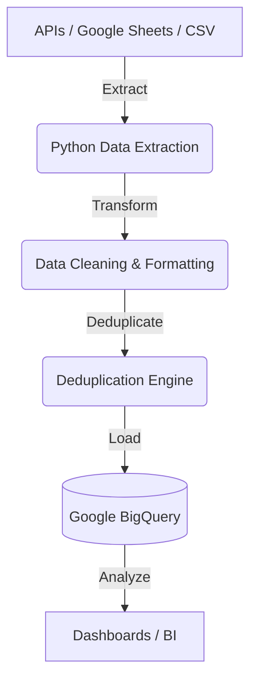

# 🚀 Revenue BigQuery ETL Pipeline

This repository contains a **production-grade ELT (Extract, Load, Transform) pipeline system** engineered to ingest CRM, telephony, and manual operational data into Google BigQuery. 

By bridging the gap between third-party APIs, published CSVs, and the Google Sheets API, this system ensures clean, deduplicated, and up-to-date data is always available for real-time analytics and automated dashboarding.

---

## 🔌 Data Sources

The ecosystem orchestrates data from five primary operational sources:
1. **Acefone (Telephony):** Inbound and outbound call logs via API.
2. **Ozonetel (Telephony):** Agent-specific daily call data via API.
3. **LeadSquared (CRM):** Prospect metadata and sales activities via API.
4. **Manual Calls (Google Sheets):** Fetched via a Published CSV URL.
5. **Revenue Data (Google Sheets):** Fetched securely via the official Google Sheets API (`googleapiclient.discovery`).

---

## 🏗️ Architecture



---

## ⚙️ Core Engineering Concepts

### 🔄 Incremental Processing
To optimize execution time and compute costs, pipelines avoid full historical refreshes:
* **Acefone:** Fetches new records based on `MAX(call_datetime)`.
* **Ozonetel:** Uses day-wise incremental fetching.
* **LSQ, Manual Calls, & Revenue:** Implements a **59-day rolling window**. This captures recent updates to existing leads/rows without querying years of historical data.

### ⏱️ Timezone & Lag Handling
* **Processing Timezone:** All mathematical and datetime logic runs in **IST (Asia/Kolkata)**.
* **Storage Timezone:** BigQuery tables are strictly stored in **UTC** or extracted specifically as `.date()` to avoid timezone shifting in BigQuery.
* **The Lag Buffer (Telephony):** A mandatory **5-minute delay** is applied before fetching the latest data to guarantee call durations are finalized by the provider.

---

## 📞 Pipeline Deep Dive

### 1️⃣ Acefone Pipeline
* **Purpose:** Fetch detailed call records.
* **Logic:** Incremental fetch using the latest BQ date + a **30-minute backward buffer** (to catch delayed webhooks) + a 5-minute lag.

### 2️⃣ LeadSquared Pipeline
* **Purpose:** Maintain up-to-date CRM prospects.
* **Logic:** 59-day rolling window using `ModifiedOn`. Automatically maps complex Owner IDs to readable Agent Names. Includes API rate-limit retry logic.

### 3️⃣ Ozonetel Pipeline
* **Purpose:** Fetch aggregated day-wise call data.
* **Logic:** Iterates day-by-day. Applies strict filtering for specific team agents to reduce data noise before pushing to BigQuery.

### 4️⃣ Manual Calls Pipeline (`manual_calls_pipeline.py`)
* **Purpose:** Digitize offline agent activities tracked via Google Forms/Sheets.
* **Extraction:** Reads a publicly published CSV URL using `requests` and `pandas`.
* **Transformations:**
  * **Smart Date Fallback:** Checks for a user-input `Manual_Date`. If missing or invalid, falls back to the automated `Timestamp`.
  * **Data Normalization:** Converts logged call durations from minutes to seconds (`* 60`).
  * **Sanitization:** Cleans float artifacts (`.0`) from phone numbers and Title Cases agent names.
* **Load Strategy:** Filters for the last 59 days and pushes via `WRITE_TRUNCATE`.

### 5️⃣ Revenue Pipeline (`revenue_pipeline.py`)
* **Purpose:** Sync month-over-month revenue targets, fees, and course prices.
* **Extraction:** Authenticates via Google Service Account to read a private Google Sheet.
* **Transformations:**
  * **Financial Cleanup:** Strips commas from `Fee_paid` and `Course_Price` strings and converts them to strict numeric floats. Drops empty fee rows.
  * **Phone Cleanup:** Strips `+91` and spaces, ensuring exact 10-digit formats.
  * **Cohort Creation:** Generates a `Rev_Month` column (first day of the month) for easier Looker Studio cohort filtering.
* **Load Strategy:** Filters for the last 59 days, applies a strict BigQuery `SchemaField` mapping, and pushes via `WRITE_TRUNCATE`.

---

## 📋 Observability & Logging

To monitor pipeline health, executions are logged into a centralized BigQuery table:
`crm_scheduled_results.MASTER_QUERY_REFRESH`

**Captured Metrics:**
* `run_date` (Date of execution)
* `pipeline_name` (Which script ran, e.g., "REVENUE")
* `run_timestamp` (Exact time of execution)
* `rows_inserted` (Volume of data processed)

---

## ⚡ Automation (GitHub Actions)

This project relies on GitHub Actions to orchestrate scheduled runs. Every workflow follows this strict sequence:
`Checkout Repo` ➔ `Setup Python` ➔ `Cache Dependencies` ➔ `Authenticate GCP` ➔ `Run Pipeline`

### 📂 Scheduled Workflows
| Workflow Name | Trigger / Schedule (IST) | Purpose |
| :--- | :--- | :--- |
| **Master Data Pipeline** 🚀 | **11:00, 13:30, 17:30, 19:30 (Mon-Fri)** | **Core Production Run.** Executes Manual Calls, Ozonetel, Acefone, Revenue, and LSQ pipelines sequentially. |
| **Manual Calls** | **07:30 Daily** | Early morning sync for Google Sheets offline tracking. |
| **Ad-Hoc Actions** | Manual (`workflow_dispatch`) | Individual pipelines can be triggered manually for instant debugging or backfilling. |

---

## 🔐 Configuration & Secrets

The following environment variables must be configured in **GitHub Settings > Secrets and variables > Actions**:
* `BQ_CREDENTIALS` (JSON Service Account Key - required for BQ and Sheets API)
* `ACEFONE_API_KEY`, `ACEFONE_ACCOUNT_ID`
* `OZONETEL_API_KEY`, `OZONETEL_USERNAME`
* `LSQ_ACCESS_KEY`, `LSQ_SECRET_KEY`

---

## 📦 Running Locally

To run and test the pipelines on your local machine:

```bash
# 1. Install required dependencies
pip install pandas requests google-cloud-bigquery google-api-python-client pytz db-dtypes

# 2. Authenticate locally (ensure your JSON key is set in your environment)
export GOOGLE_APPLICATION_CREDENTIALS="/path/to/your/service-account-file.json"

# 3. Execute individual pipelines
python manual_calls_pipeline.py
python revenue_pipeline.py
```

---

**Author:** [Amit Ray](amitray@lawsikho.in)
⭐ *Star this repository if you found these ETL patterns useful!*
