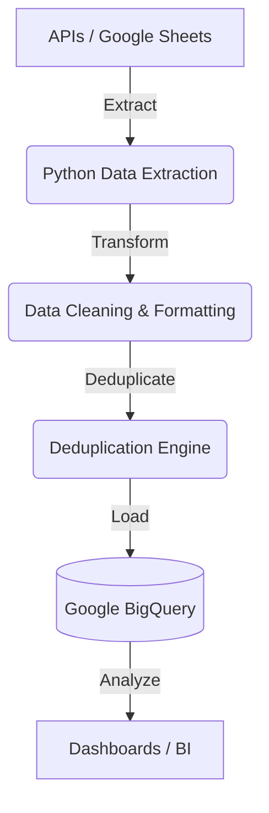

# 🚀 Revenue BigQuery ELT Pipeline

This repository contains a **production-grade ELT (Extract, Load, Transform) pipeline system** engineered to ingest CRM, telephony, and manual operational data into Google BigQuery. 

By bridging the gap between third-party APIs and BigQuery, this system ensures clean, deduplicated, and up-to-date data is always available for real-time analytics and automated dashboarding.

---

## 🔌 Data Sources

The ecosystem orchestrates data from five primary operational sources:
1. **Acefone (Telephony):** Inbound and outbound call logs.
2. **Ozonetel (Telephony):** Agent-specific daily call data.
3. **LeadSquared (CRM):** Prospect metadata and sales activities.
4. **Google Sheets (Manual Calls):** Manually logged offline calls.
5. **Google Sheets (Revenue Data):** Month-over-month revenue targets and achievements.

---

## 🏗️ Architecture



---

## ⚙️ Core Engineering Concepts

### 🔄 Incremental Processing
To optimize API usage, execution time, and compute costs, the pipelines avoid full historical refreshes where possible:
* **Acefone:** Fetches new records dynamically based on `MAX(call_datetime)` found in BigQuery.
* **Ozonetel:** Uses day-wise incremental fetching.
* **LeadSquared (LSQ):** Implements a **59-day rolling window** utilizing the `ModifiedOn` parameter to capture updates to existing leads without querying the entire CRM history.

### ⏱️ Timezone & Lag Handling
Telephony APIs are notorious for partial records if queried instantly. 
* **Processing Timezone:** All mathematical and datetime logic runs in **IST (Asia/Kolkata)**.
* **Storage Timezone:** BigQuery tables are strictly stored in **UTC** to maintain global data consistency.
* **The Lag Buffer:** A mandatory **5-minute delay** is applied before fetching the latest data. This guarantees that ongoing calls are completed and their durations are fully finalized by the provider before ingestion.

### 🔁 Deduplication Strategy
Deduplication is handled locally in Python before the BigQuery upload to ensure the destination tables remain clean.
| Source Pipeline | Deduplication Logic (Primary Key) | Load Strategy |
| :--- | :--- | :--- |
| **Acefone** | `call_id` | Append |
| **Ozonetel** | `CallID` + `StartTime` + `EndTime` | Append |
| **LeadSquared** | `ProspectID` | Overwrite (59-day subset) |
| **Google Sheets** | Full Refresh | Overwrite (`WRITE_TRUNCATE`) |

---

## 📞 Pipeline Deep Dive

### 1️⃣ Acefone Pipeline
* **Purpose:** Fetch detailed call records.
* **Logic:** Incremental fetch using the latest `call_datetime` stored in BQ. Includes a **30-minute backward buffer** to catch any delayed webhook logs, plus the standard 5-minute lag.
* **Filters:** Extracts all *Outbound* calls, but restricts *Inbound* calls to "Answered" only.

### 2️⃣ LeadSquared Pipeline
* **Purpose:** Maintain up-to-date CRM prospects.
* **Logic:** Fetches the last 59 days of data. Automatically maps complex Owner IDs to readable Agent Names. 
* **Resilience:** Includes built-in API retry logic to handle rate-limiting.

### 3️⃣ Ozonetel Pipeline
* **Purpose:** Fetch aggregated day-wise call data.
* **Logic:** Iterates day-by-day. Applies strict filtering for specific team agents to reduce data noise before pushing to BigQuery.

### 4️⃣ Manual Calls & Revenue Pipelines
* **Purpose:** Digitize offline data tracked in Google Sheets.
* **Logic:** Converts logged minutes into seconds for parity with API data, sanitizes numeric values, creates `Rev_Month` cohorts, and pushes via a clean `WRITE_TRUNCATE`.

---

## 📋 Observability & Logging

To monitor pipeline health, all runs log execution metadata into a centralized BigQuery table:
`crm_scheduled_results.MASTER_QUERY_REFRESH`

**Captured Metrics:**
* `run_date` (Date of execution)
* `pipeline_name` (Which script ran)
* `run_timestamp` (Exact time of execution)
* `rows_inserted` (Volume of data processed)

---

## ⚡ Automation (GitHub Actions)

This project relies on GitHub Actions to orchestrate scheduled runs. Every workflow follows this strict sequence:
`Checkout Repo` ➔ `Setup Python` ➔ `Cache Dependencies` ➔ `Authenticate GCP` ➔ `Run Pipeline`

### 📂 Scheduled Workflows
| Workflow Name | Trigger / Schedule (IST) | Purpose |
| :--- | :--- | :--- |
| **Master Data Pipeline** 🚀 | **11:00, 13:30, 17:30, 19:30 (Mon-Fri)** | **Core Production Run.** Executes Manual Calls, Ozonetel, Acefone, Revenue, and LSQ pipelines sequentially. |
| **Manual Calls** | **07:30 Daily** | Early morning sync for Google Sheets offline tracking. |
| **Ad-Hoc Actions** | Manual (`workflow_dispatch`) | Individual pipelines can be triggered manually for instant debugging or backfilling. |

---

## 🔐 Configuration & Secrets

The following environment variables must be configured in **GitHub Settings > Secrets and variables > Actions**:
* `BQ_CREDENTIALS` (JSON Service Account Key)
* `ACEFONE_API_KEY`, `ACEFONE_ACCOUNT_ID`
* `OZONETEL_API_KEY`, `OZONETEL_USERNAME`
* `LSQ_ACCESS_KEY`, `LSQ_SECRET_KEY`
* `TEAM_SHEET_URL`

---

## 📦 Running Locally

To run and test the pipelines on your local machine:

```bash
# 1. Install required dependencies
pip install -r requirements.txt

# 2. Run an individual pipeline
python acefone_pipeline.py
python lsq_pipeline.py
```
*(Ensure your local environment has the required API keys exported or stored in a `.env` file, and your `GOOGLE_APPLICATION_CREDENTIALS` path is set).*

---

**Author:** [Amit Ray](https://github.com/amitray-lawsikho)  
⭐ *Star this repository if you found these ETL patterns useful!*
